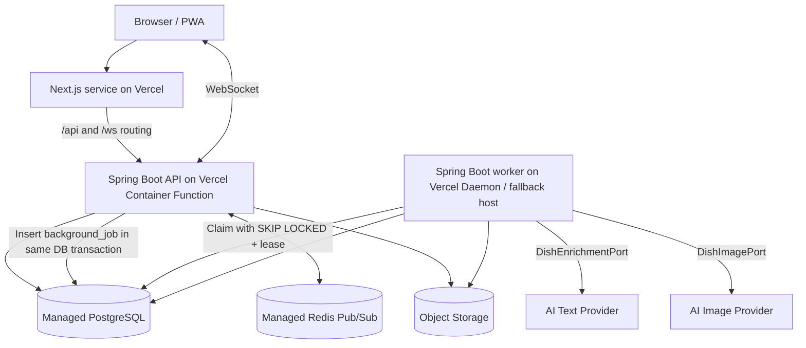
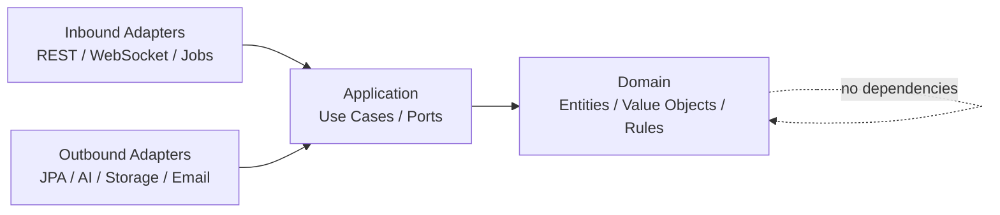
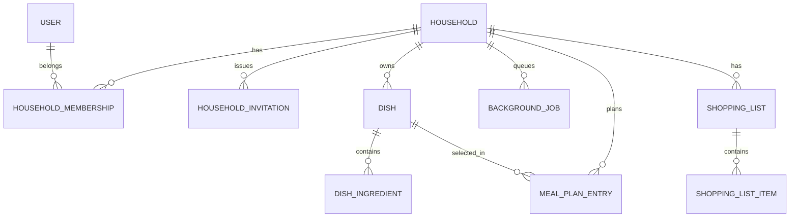

# PrepPari — Product Requirements & Technical Design

> **Documento de handoff para implementación**  
> Versión: 1.2  
> Estado: scope inicial del MVP · marca PrepPari · identidad Tomato & Butter · cola asíncrona PostgreSQL · despliegue Vercel-first  
> Idioma del producto: español (Argentina)  
> Zona horaria inicial: `America/Argentina/Buenos_Aires`

---

## 0. Instrucciones para el agente de desarrollo

Este documento define el producto y una arquitectura inicial. Antes de implementar:

1. Leer el documento completo y respetar el scope del MVP.
2. No agregar funcionalidades fuera del MVP sin consultar.
3. Priorizar un flujo completo y usable de punta a punta antes que construir muchas pantallas aisladas.
4. Mantener el backend como **monolito modular con arquitectura hexagonal**. No crear microservicios.
5. Mantener el dominio independiente de Spring, JPA, HTTP, proveedores de IA y servicios externos.
6. No llamar al proveedor de IA desde el frontend ni exponer claves API al cliente.
7. La IA propone datos; el usuario puede revisarlos y corregirlos. Nunca presentar cantidades inferidas como si fueran datos confirmados.
8. La lista de compras es compartida por hogar y debe preservar los productos agregados manualmente al actualizar los productos generados desde el planificador.
9. Todas las operaciones deben validar pertenencia del usuario al hogar correspondiente. Nunca confiar solamente en un `householdId` enviado por el frontend.
10. Utilizar la identidad visual Tomato & Butter definida en la sección 14.5; implementar tokens centralizados y no reutilizar la paleta de Mi Cucha.
11. Implementar trabajos durables mediante `BackgroundJob` en PostgreSQL y un worker independiente. Redis es solo Pub/Sub realtime; no introducir otro broker en el MVP.
12. Escribir tests para reglas de negocio, especialmente escalado de porciones, consolidación de ingredientes, actualización de listas, aislamiento entre hogares y concurrencia/recuperación de jobs.

Si algún detalle no está definido, elegir la solución más sencilla que preserve estas reglas, documentar la decisión y evitar sobreingeniería.

---

# PARTE I — DEFINICIÓN FUNCIONAL

## 1. Visión del producto

**Nombre del producto: PrepPari.** Usar `PrepPari` en la documentación, textos de interfaz, título del repositorio y branding inicial. El nombre puede escribirse `preppari` en slugs, package identifiers, nombres técnicos y URLs. No introducir el nombre anterior “Smart Kitchen” en nuevas pantallas o documentación.

**PrepPari** es una aplicación web para organizar las comidas de un hogar. Permite guardar comidas de manera rápida, planificar almuerzos y cenas y generar una lista de compras compartida a partir de ese plan.

La aplicación no debe sentirse como un recetario tradicional que obliga al usuario a cargar manualmente cada ingrediente y cada paso. El usuario puede guardar una comida escribiendo solamente su nombre. PrepPari utiliza IA para sugerir ingredientes, cantidades, porciones y una imagen ilustrativa. El usuario puede revisar y corregir la información antes de utilizarla para planificar y comprar.

### 1.1. Problema que resuelve

En la vida cotidiana, decidir qué cocinar, recordar comidas posibles y organizar las compras suele estar distribuido entre notas, mensajes, recetas guardadas en redes sociales y listas manuales.

PrepPari centraliza ese proceso:

1. Guardar las comidas que el hogar suele preparar.
2. Organizar qué se va a comer cada día.
3. Calcular los ingredientes necesarios según las porciones.
4. Consolidar ingredientes repetidos en una lista de compras.
5. Compartir esa lista entre los miembros del hogar y actualizarla en tiempo real.

### 1.2. Usuario objetivo inicial

- Una persona o pareja que cocina habitualmente en casa.
- Un hogar pequeño, inicialmente de una o dos personas, aunque el modelo debe admitir más miembros.
- Usuarios que quieren reducir la carga mental de decidir comidas y organizar las compras.
- Usuarios que no quieren escribir recetas extensas ni cargar ingredientes manualmente desde cero.

### 1.3. Principios de producto

- **Captura rápida:** guardar una comida debe requerir muy pocos datos.
- **IA como asistente:** la IA reduce la carga manual, pero no reemplaza la revisión del usuario.
- **Una sola fuente de verdad:** las comidas guardadas se reutilizan en el planificador.
- **Planificación conectada con compras:** la lista se genera desde las comidas y porciones planificadas.
- **Colaboración sencilla:** todos los miembros de un hogar trabajan sobre la misma biblioteca, plan y lista.
- **Transparencia:** distinguir información confirmada, estimada y pendiente.
- **Mobile-first:** la lista de compras debe ser cómoda de utilizar desde un teléfono mientras se está en el supermercado.

---

## 2. Objetivos y no objetivos del MVP

### 2.1. Objetivos

El MVP se considera exitoso cuando un hogar puede:

- Crear una cuenta e iniciar un hogar compartido.
- Guardar una comida escribiendo un título.
- Obtener ingredientes sugeridos mediante IA y una imagen ilustrativa si el proveedor está disponible.
- Revisar y editar esos ingredientes.
- Organizar almuerzos y cenas en un calendario semanal.
- Definir las porciones necesarias para cada comida.
- Generar una lista de compras semanal a partir del calendario.
- Consolidar ingredientes repetidos con unidades compatibles.
- Agregar productos manuales sin que desaparezcan al actualizar la lista.
- Compartir y actualizar la lista en tiempo real con otros miembros del hogar.

### 2.2. Fuera del MVP

No implementar inicialmente:

- Importación de recetas desde TikTok, Instagram o videos.
- Importación genérica desde cualquier URL.
- Pasos o instrucciones de preparación generados por IA.
- Inventario de despensa o stock de alimentos.
- Control de vencimientos.
- Información nutricional, calorías o macros.
- Comparación de precios de supermercados.
- Integración con supermercados o delivery.
- Escaneo de códigos de barras.
- Comunidad pública, perfiles públicos o publicación de recetas.
- Aplicaciones nativas iOS/Android. La primera versión es web responsive/PWA.
- Planificación automática basada en preferencias o inventario.
- Costos de recetas o cálculo del costo por porción.

La arquitectura puede permitir incorporar estas capacidades luego, pero no deben condicionar el desarrollo del MVP.

---

## 3. Conceptos y vocabulario del dominio

Para evitar ambigüedades, utilizar los siguientes conceptos:

| Concepto | Definición |
|---|---|
| **Household / Hogar** | Espacio compartido por una o más personas. Es el límite principal de colaboración y acceso a datos. |
| **Dish / Comida** | Elemento guardado en la biblioteca del hogar. Tiene un título y puede tener imagen, categoría, porciones e ingredientes. Puede existir sin ingredientes. |
| **Dish Ingredient / Ingrediente de comida** | Ingrediente estructurado asociado a una comida, con cantidad, unidad y nivel de confianza/origen. |
| **Meal Plan Entry / Comida planificada** | Uso de una comida en una fecha y tipo de comida (almuerzo o cena), con una cantidad específica de porciones. |
| **Shopping List / Lista de compras** | Lista compartida de un hogar para una semana determinada. |
| **Shopping List Item / Ítem de compra** | Producto manual o generado desde el planificador. Puede estar pendiente o comprado. |
| **Enrichment / Enriquecimiento** | Proceso de IA que completa ingredientes y, opcionalmente, genera una imagen para una comida. |

En la interfaz se pueden utilizar expresiones más naturales como “Mis comidas”, “Plan semanal” y “Lista de compras”. En el backend, mantener nombres de dominio consistentes.

---

## 4. Funcionalidades del MVP

### 4.1. Usuarios y hogares

**Incluido:**

- Registro e inicio de sesión.
- Crear un hogar.
- El usuario que crea el hogar queda como `OWNER`.
- Invitar a otra persona mediante un enlace/token de invitación o email.
- Aceptar invitación y unirse al hogar.
- Ver los miembros del hogar.
- Todos los miembros activos pueden consultar y editar la biblioteca, el plan y la lista.
- El propietario puede revocar invitaciones y remover miembros.
- Los datos son privados del hogar.

**Decisión para el MVP:** una biblioteca compartida por hogar. No implementar bibliotecas personales ni compartir recetas entre hogares.

**Roles iniciales:**

- `OWNER`: administra miembros y configuración del hogar; también puede operar sobre todos los datos.
- `MEMBER`: puede crear/editar comidas, planificar y operar la lista.

### 4.2. Biblioteca de comidas

La biblioteca no debe exigir una receta extensa. La creación rápida requiere solamente un título.

**Funcionalidades:**

- Crear una comida indicando título.
- Foto opcional cargada por el usuario.
- Opción de generar ingredientes y una imagen ilustrativa con IA.
- Definir o corregir la cantidad de porciones base.
- Agregar, editar y eliminar ingredientes manualmente.
- Cambiar o quitar la imagen.
- Seleccionar categoría.
- Marcar/desmarcar como favorita.
- Buscar por nombre.
- Buscar por ingrediente.
- Filtrar por categoría y favoritos.
- Consultar el estado del enriquecimiento: pendiente, completo, parcial o fallido.
- Guardar una comida aunque todavía no tenga ingredientes.

**Categorías iniciales sugeridas:**

- Pastas
- Tartas y empanadas
- Carnes
- Pollo
- Pescados
- Ensaladas
- Verduras
- Arroces y cereales
- Sopas y guisos
- Sandwiches
- Otros

Las categorías pueden mantenerse como catálogo configurable o enum persistido. Evitar lógica de negocio dependiente de textos traducidos de la UI.

#### 4.2.1. Enriquecimiento por IA a partir del título

Ejemplo de entrada: `Tarta de verduras`.

El servicio de IA debe sugerir:

- Nombre normalizado, opcionalmente.
- Cantidad de porciones base (valor sugerido por defecto, por ejemplo 4).
- Ingredientes.
- Cantidades estimadas.
- Unidades.
- Categoría de cada ingrediente.
- Nivel de confianza/origen de la cantidad.
- Una descripción corta opcional; no es necesaria para el MVP.
- Una imagen ilustrativa del plato, si el proveedor de imágenes está configurado.

**No generar pasos de preparación en el MVP.**

La generación debe devolver datos estructurados. No aceptar una respuesta de texto libre como contrato de integración.

El resultado es una sugerencia editable. El usuario debe poder:

- Aceptar la sugerencia completa.
- Editar ingredientes y cantidades antes de guardar.
- Eliminar ingredientes que no utiliza.
- Agregar ingredientes faltantes.
- Regenerar ingredientes explícitamente, entendiendo que se reemplazarán las sugerencias anteriores no confirmadas.

**No sobrescribir silenciosamente correcciones del usuario.** Una regeneración debe requerir confirmación si ya existen cambios manuales.

#### 4.2.2. Origen y confianza de los ingredientes

Cada ingrediente debe distinguir, como mínimo:

- `AI_ESTIMATED`: sugerido por IA, cantidad estimada.
- `AI_EXPLICIT`: la IA detectó una cantidad explícita en una fuente (en futuras importaciones).
- `USER_DEFINED`: agregado o corregido por el usuario.
- `UNKNOWN`: cantidad o unidad desconocida.

Para el MVP de generación por título, los ingredientes normalmente serán `AI_ESTIMATED`; cualquier edición manual pasa a `USER_DEFINED`.

Mostrar una indicación discreta cuando las cantidades sean estimadas. No es necesario mostrar información técnica en cada tarjeta, pero sí al revisar los ingredientes.

#### 4.2.3. Imagen de la comida

Orden de preferencia:

1. Imagen cargada por el usuario.
2. Imagen generada por un proveedor de generación de imágenes, si está habilitado.
3. Placeholder visual por categoría si no hay imagen o falla el proveedor.

La generación de imagen no debe bloquear la creación de la comida ni la generación de ingredientes. Debe ser un proceso independiente y tolerante a fallos.

Guardar las imágenes en object storage propio/controlado por la aplicación. No depender de una URL temporal del proveedor.

### 4.3. Planificador semanal

**Funcionalidades:**

- Vista semanal de lunes a domingo.
- Dos espacios por día: `LUNCH` (almuerzo) y `DINNER` (cena).
- Agregar una comida guardada a un espacio.
- Definir cantidad de porciones para esa planificación.
- Editar porciones.
- Cambiar una comida por otra.
- Mover una comida a otro día/espacio.
- Eliminar una planificación.
- Navegar entre semanas.
- Acceder a los ingredientes de una comida desde el planificador.

**Reglas:**

- Una entrada representa una comida en una fecha y tipo de comida.
- Para el MVP se permite una sola comida por hogar, fecha y tipo (`household + date + meal_type` unique). Si se necesita más de un plato, se puede representar como una comida compuesta en la biblioteca; no agregar múltiples slots todavía.
- Las porciones de la planificación son independientes de las porciones base guardadas en la comida.
- Cambiar las porciones planificadas nunca modifica la comida original.
- Fechas almacenadas como `DATE`; no convertirlas a timestamps UTC.
- La semana comienza el lunes.

### 4.4. Lista de compras compartida

Es una de las funcionalidades centrales del MVP.

**Funcionalidades:**

- Una lista por hogar y semana.
- Generar la lista a partir de las comidas planificadas de esa semana.
- Mostrar ingredientes faltantes o comidas sin ingredientes configurados.
- Escalar cantidades según las porciones planificadas.
- Consolidar ingredientes repetidos.
- Sumar cantidades únicamente cuando las unidades sean compatibles.
- Categorizar productos.
- Agregar productos manualmente.
- Editar nombre, cantidad, unidad y categoría.
- Eliminar productos.
- Marcar como comprado/no comprado.
- Mostrar progreso de compras (por ejemplo, `5 de 12 comprados`).
- Compartir la lista con todos los miembros del hogar.
- Sincronizar cambios en tiempo real entre dispositivos.

#### 4.4.1. Generación y actualización de la lista

La primera generación y las actualizaciones posteriores se realizan mediante una acción explícita: **“Generar lista”** o **“Actualizar desde el plan”**. No recalcular automáticamente ante cada cambio del calendario.

Esto permite al usuario controlar cuándo se modifica su lista.

Al generar/actualizar:

1. Leer las comidas planificadas de la semana.
2. Obtener ingredientes de cada comida.
3. Detectar comidas sin ingredientes o con datos incompletos.
4. Escalar las cantidades según las porciones planificadas.
5. Normalizar ingredientes y unidades.
6. Consolidar los ingredientes compatibles.
7. Crear o actualizar los ítems generados.
8. Mantener intactos los productos agregados manualmente.
9. Conservar el estado de compra para ítems que siguen representando el mismo requerimiento y cuya cantidad no cambió.
10. Si cambia la cantidad requerida de un ítem generado, volverlo a `PENDING` para evitar mostrar como comprado un requerimiento distinto.
11. Si un ítem generado deja de ser necesario, eliminarlo si estaba pendiente; conservarlo como comprado si ya había sido marcado como comprado, para no borrar el historial de lo que el usuario indicó haber comprado.

**Productos manuales:** nunca deben borrarse ni modificarse por una actualización del planificador.

**Duplicados manuales/generados:** para mantener el MVP simple y seguro, la consolidación automática se aplica entre ingredientes generados desde comidas. Los productos agregados manualmente se conservan como ítems manuales independientes, incluso si tienen el mismo nombre. La UI puede advertir sobre un posible duplicado; no fusionarlos automáticamente.

#### 4.4.2. Comidas sin ingredientes

Una comida puede estar guardada sin ingredientes. Si se planifica y luego se genera la lista:

- No inventar ingredientes silenciosamente.
- No generar una lista incompleta como si estuviera completa.
- Incluir una advertencia con las comidas que necesitan ingredientes.
- Permitir navegar directamente a esa comida para completar/generar ingredientes.
- Los demás ingredientes disponibles sí pueden incluirse en la lista.

La respuesta de la operación de generación debe indicar `incompleteDishes` o equivalente.

#### 4.4.3. Consolidación de ingredientes

Ejemplo:

- Lunes: 400 g de espinaca.
- Miércoles: 200 g de espinaca.
- Resultado: 600 g de espinaca.

Reglas iniciales:

- Normalizar mayúsculas, acentos, espacios y variantes simples/plurales.
- Usar una clave normalizada para identificar ingredientes iguales.
- Consolidar únicamente unidades compatibles.
- Conversiones MVP:
  - `kg` ↔ `g`.
  - `l` ↔ `ml`.
  - `unit` ↔ `units` / `unidad` ↔ `unidades`.
- No convertir automáticamente volumen a peso (por ejemplo, tazas a gramos), porque depende del ingrediente.
- No sumar cantidades sin unidad con cantidades que sí tienen unidad.
- Ingredientes sin cantidad/unidad se incluyen con indicador “cantidad a definir”.
- Evitar consolidar términos que solo se parecen semánticamente. Ejemplo: cebolla de verdeo y cebolla no necesariamente son equivalentes.

Para MVP, empezar con normalización determinística y un pequeño catálogo de alias. No depender de una nueva llamada de IA para cada consolidación.

#### 4.4.4. Categorías de compra

Categorías iniciales:

- Verdulería
- Carnicería
- Pescadería
- Lácteos y huevos
- Almacén
- Panadería
- Congelados
- Bebidas
- Limpieza y hogar
- Otros

Los ingredientes generados pueden traer una categoría sugerida por IA, pero el backend debe validar y mapear a categorías permitidas. Los ítems manuales pueden usar una categoría elegida por el usuario.

### 4.5. Dashboard / Inicio

Pantalla de entrada simple con:

- Comidas de hoy (almuerzo y cena).
- Resumen de los próximos días.
- Acceso al planificador semanal.
- Estado de la lista de compras de la semana.
- Acceso rápido para agregar una comida.

No incluir métricas decorativas ni gráficos en el MVP.

### 4.6. Responsive / PWA

- Diseño mobile-first.
- La biblioteca y el planificador deben ser usables en desktop y mobile.
- La lista de compras debe priorizar una experiencia mobile cómoda: targets táctiles grandes, categorías agrupadas, checkboxes visibles y mínima navegación.
- Instalable como PWA si no agrega complejidad excesiva.
- No se requiere soporte offline completo en el MVP. Se puede mantener la última lista visible en caché, pero las mutaciones requieren conexión y deben confirmar el resultado del servidor.

---

## 5. Flujos principales de usuario

### 5.1. Crear una comida rápidamente

1. El usuario hace clic en “Agregar comida”.
2. Ingresa un título, por ejemplo `Tarta de verduras`.
3. Opcionalmente sube una foto.
4. Elige “Generar ingredientes con IA”.
5. La aplicación crea la comida y ejecuta el enriquecimiento.
6. Se muestran los ingredientes sugeridos, porciones y estado de imagen.
7. El usuario corrige, elimina o agrega ingredientes.
8. Confirma y la comida queda disponible en la biblioteca compartida.

También debe poder guardar solamente el título y completar ingredientes después.

### 5.2. Planificar una semana

1. El usuario abre el planificador.
2. Selecciona una semana.
3. En un día y espacio (almuerzo/cena), selecciona una comida de la biblioteca.
4. Define porciones.
5. Repite para los demás días.
6. Los demás miembros del hogar ven el plan actualizado.

### 5.3. Generar y compartir la lista

1. El usuario abre la lista de compras de la semana.
2. Presiona “Generar/Actualizar desde el plan”.
3. El backend consolida ingredientes y devuelve advertencias si hay comidas incompletas.
4. El usuario agrega productos manuales que necesita comprar.
5. Otro miembro del hogar abre la misma lista.
6. Ambos pueden marcar productos como comprados; los cambios se reflejan en tiempo real.

### 5.4. Corregir una comida generada con IA

1. El usuario abre una comida.
2. Edita el nombre/cantidad/unidad de un ingrediente.
3. El ingrediente editado pasa a tener origen `USER_DEFINED`.
4. La modificación queda guardada y se utilizará en futuras planificaciones.
5. Una regeneración posterior debe advertir que existen cambios manuales antes de reemplazar sugerencias.

---

## 6. Criterios de aceptación del MVP

- [ ] Un usuario puede registrarse e iniciar sesión.
- [ ] Un usuario puede crear un hogar.
- [ ] Un propietario puede invitar a otro usuario y ese usuario puede unirse.
- [ ] Un miembro del hogar puede ver y editar la biblioteca compartida.
- [ ] Se puede guardar una comida ingresando únicamente el título.
- [ ] Se puede pedir a la IA ingredientes estructurados para esa comida.
- [ ] El resultado de IA se puede revisar y editar.
- [ ] Una comida puede guardarse sin ingredientes.
- [ ] Se puede buscar por título e ingrediente.
- [ ] Se puede planificar almuerzo y cena para cada día de la semana.
- [ ] Se puede seleccionar la cantidad de porciones por planificación.
- [ ] Las porciones planificadas no alteran la receta base.
- [ ] Se puede generar una lista desde el plan semanal.
- [ ] Los ingredientes repetidos compatibles se consolidan y escalan correctamente.
- [ ] Los ingredientes con cantidades desconocidas aparecen como pendientes de definir.
- [ ] Las comidas sin ingredientes se informan como incompletas.
- [ ] Los productos manuales sobreviven a una actualización de la lista.
- [ ] Los miembros del hogar ven la misma lista.
- [ ] Los cambios de estado de compra se sincronizan en tiempo real.
- [ ] Un usuario de un hogar no puede consultar ni modificar datos de otro hogar.

---

# PARTE II — DEFINICIÓN TÉCNICA

## 7. Arquitectura recomendada

### 7.1. Decisión: monolito modular + arquitectura hexagonal

Recomiendo una arquitectura **hexagonal (Ports & Adapters)** dentro de un **monolito modular**.

No recomiendo microservicios para este MVP. Las funcionalidades comparten transacciones y conceptos de dominio (hogar, comidas, planificador y compras). Separarlas ahora generaría complejidad de despliegue, observabilidad, comunicación, consistencia y desarrollo sin aportar un beneficio proporcional.

La solución propuesta permite:

- Mantener las reglas de negocio independientes de frameworks y proveedores.
- Sustituir Gemini por otro proveedor sin reescribir los casos de uso.
- Sustituir almacenamiento local por S3-compatible sin alterar el dominio.
- Separar módulos funcionales con límites claros.
- Escalar horizontalmente la aplicación y los workers cuando sea necesario.
- Extraer un módulo a un servicio independiente en el futuro si existe una necesidad real.

**Principio:** modularidad primero; distribución física solo cuando el producto lo requiera.

### 7.2. Stack sugerido

| Capa | Tecnología sugerida | Notas |
|---|---|---|
| Frontend | Next.js + React + TypeScript | Web responsive; PWA opcional. Deploy como servicio Next.js en Vercel. |
| UI | Tailwind CSS + librería de componentes consistente | Mantener accesibilidad y diseño mobile-first. |
| Backend | Java 21+ + Spring Boot | API REST versionada; empaquetada como imagen OCI/Docker y desplegada en Vercel Container Runtime. |
| Arquitectura backend | Monolito modular + arquitectura hexagonal | Un solo backend de dominio; API HTTP y worker son procesos de ejecución separados del mismo código/artifact cuando sea conveniente. |
| Seguridad | Spring Security + JWT/OIDC | El backend valida tokens; no confiar en IDs del cliente. |
| Persistencia | PostgreSQL administrado | Servicio externo a Vercel; elegir región cercana a la región de ejecución y usar pooling/conexiones limitadas. |
| Migraciones | Flyway | Esquema versionado en Git; ejecutar migraciones como paso controlado de release, no desde cada instancia concurrente. |
| ORM | Spring Data JPA / Hibernate en el adapter de persistencia | No filtrar entidades JPA al dominio ni a la API. |
| Archivos | Object storage S3-compatible o Vercel Blob | Fotos de comidas y assets; nunca depender del filesystem local de una Function. |
| IA texto | Gemini u otro proveedor detrás de un port | Modelo y proveedor configurables. Salida estructurada validada. |
| IA imagen | Proveedor intercambiable | Opcional y desacoplado del enriquecimiento de texto. |
| Tiempo real | Spring WebSocket en API + Redis Pub/Sub administrado | Redis distribuye eventos realtime entre instancias; no se usa como cola durable de trabajos. |
| Cola de trabajos | Tabla `background_job` en PostgreSQL | Cola durable inicial; claim concurrente con `FOR UPDATE SKIP LOCKED`, leases e idempotencia. No sumar broker dedicado en MVP. |
| Worker | Proceso Java/Spring Boot desplegado como Vercel Daemon si se valida disponibilidad | Consume jobs de PostgreSQL; proceso separado, sin HTTP ni estado durable local. Railway/Render como fallback. |
| Tests | JUnit 5, Mockito, Testcontainers | Tests de dominio e integración con PostgreSQL real. |
| Contenedores | Docker / Docker Compose | Desarrollo local reproducible; los mismos Dockerfiles sirven como base para Vercel Container Runtime/Daemons. |
| Hosting | Vercel Services + Container Runtime + Daemons | Permite frontend, API contenedorizada y worker en un proyecto. Services y Container Runtime están en beta; Daemons está en beta y es producción-only durante esta etapa. |

Las versiones exactas deben fijarse al crear el proyecto. No hardcodear modelos de IA en el código: usar configuración por ambiente. Ver la sección 18 para el modelo de despliegue, limitaciones de Vercel y alternativa de hosting.

### 7.3. Diagrama de alto nivel



El frontend, API y worker pueden desplegarse dentro de un proyecto Vercel usando Services, Container Runtime y Daemons. PostgreSQL, Redis y el object storage son servicios administrados externos. El estado durable nunca vive en memoria ni en el filesystem local de las instancias Vercel.

### 7.4. Objetivo de despliegue: Vercel-first

El objetivo inicial es desplegar el frontend y los procesos HTTP del backend en Vercel, sin cambiar el stack Java/Spring Boot.

A fecha de esta versión del documento (20 de noviembre de 2026), Vercel ofrece:

- **Vercel Services (beta):** permite desplegar varios servicios dentro de un proyecto y enrutar paths al servicio correspondiente.
- **Vercel Container Runtime (beta):** ejecuta imágenes OCI construidas desde Dockerfile. Permite empaquetar aplicaciones Java/Spring Boot como servicio HTTP.
- **Vercel WebSockets:** soporta conexiones WebSocket en Functions, incluidas Container Functions. Las conexiones quedan asociadas a una instancia y se cierran al alcanzar la duración máxima de la Function; el cliente debe reconectar.
- **Vercel Daemons (beta):** ejecuta workers contenedorizados que consumen trabajos de forma continua. Durante la beta son de producción únicamente, tienen cantidad de instancias configurada manualmente y no proporcionan filesystem persistente ni endpoint HTTP.

Estas capacidades hacen viable el despliegue Vercel-first, pero no deben tratarse como un servidor Java tradicional siempre encendido. Las Functions HTTP escalan a cero cuando no reciben tráfico y son stateless; el backend debe guardar todo estado durable en servicios externos. Revisar límites, duración máxima, regiones, cuotas y precios del plan Vercel antes de producción.

#### Topología propuesta

- `frontend/`: Next.js, desplegado como servicio web en Vercel.
- `backend/`: Spring Boot modular, empaquetado en Docker y desplegado como Container Function para REST y WebSocket.
- `backend/` también contiene el modo de ejecución del worker, lanzado como Vercel Daemon con otro comando. La API y el worker comparten dominio y adapters, pero corren en procesos separados.
- PostgreSQL administrado fuera de Vercel, preferentemente en la misma región o una región cercana al backend. Usar un pool de conexiones administrado cuando aplique y mantener HikariCP con un máximo bajo por instancia para evitar agotar conexiones al escalar horizontalmente.
- Redis administrado para Pub/Sub entre instancias API, necesario porque la memoria de una instancia Vercel no es compartida con las demás.
- Object storage externo o Vercel Blob para imágenes. Nunca utilizar el filesystem local como almacenamiento permanente.
- Proveedores de IA externos, invocados desde el worker, nunca desde el frontend.

#### Enrutamiento y dominio

Usar un único dominio público de Vercel. La tabla de rewrites debe dirigir:

- `/api/*` al servicio Spring Boot.
- `/ws/*` al mismo servicio Spring Boot para el handshake WebSocket.
- El resto de las rutas al frontend Next.js.

Esto permite que el navegador use paths same-origin y evita configurar CORS entre frontend y backend. Si se usa un subdominio o un backend fuera de Vercel, configurar CORS de forma explícita y restrictiva.

#### Vercel Services y configuración conceptual

La configuración debe declarar un servicio Next.js, un servicio API con `runtime: "container"` y una regla de rewrite para `/api/*` y `/ws/*`. Declarar además un Daemon con el Dockerfile del backend y un comando que arranque el modo worker.

La sintaxis y los campos exactos de `vercel.json` deben contrastarse con la documentación vigente de Vercel al implementar; evitar copiar ciegamente un ejemplo antiguo de `experimentalServices`. El modelo vigente es `services`.

#### Implicaciones operativas

- Las Container Functions pueden escalar a cero después de un período sin tráfico. Esperar posibles cold starts del proceso JVM; optimizar imagen y startup, y medir antes de ajustar.
- Las instancias API son efímeras. No almacenar sesiones, jobs, archivos ni locks en memoria local.
- WebSockets requieren lógica de reconexión en el frontend y resincronización consultando REST al reconectar. No depender de afinidad entre conexiones futuras.
- Redis Pub/Sub (o un servicio equivalente) debe coordinar eventos entre instancias. Un broker en memoria local no es suficiente.
- Los Daemons no son Functions HTTP: no reciben requests entrantes. Su único trabajo es reclamar y procesar jobs.
- Durante la beta, los Daemons corren en producción y no en previews. Para probar el worker en local usar Docker Compose; para staging usar un worker dedicado no productivo o un proceso local controlado.
- Los Daemons tienen capacidad configurada, no autoscaling por tráfico, y consumen recursos mientras permanecen activos. En planes con cuotas, verificar el impacto del worker siempre activo.
- Todas las tareas deben ser idempotentes y recuperables ante reinicios, SIGTERM, despliegues o pérdida temporal de conexiones.

#### Alternativa si las capacidades beta no resultan adecuadas

Mantener Next.js en Vercel y desplegar el backend Spring Boot (API + worker) como servicio Docker persistente en Railway o Render. La arquitectura hexagonal, el modelo de dominio, la API y el contrato del frontend no cambian. La diferencia queda limitada a configuración de despliegue, networking y CORS. Railway documenta despliegues de Spring Boot desde GitHub o Dockerfile.

No migrar a microservicios ni reescribir el backend en Node.js solamente por el hosting.

---

## 8. Backend: arquitectura hexagonal

### 8.1. Reglas de dependencia

La dirección de dependencias debe ser hacia el centro:

- `domain` no depende de Spring, JPA, HTTP, SDKs externos ni proveedores.
- `application` depende de `domain` y declara puertos/interfaces necesarios.
- `adapters.in` (REST, WebSocket, scheduler) invocan casos de uso de `application`.
- `adapters.out` implementan puertos usando PostgreSQL, object storage, IA, email, etc.
- Los adapters no deben contener reglas de negocio centrales.



### 8.2. Organización por módulos de negocio

Organizar primero por módulo funcional y luego por capas hexagonales. Evitar un único paquete global `controllers`, `services`, `repositories` que mezcle dominios.

Estructura orientativa:

```text
backend/
  src/main/java/com/preppari/
    PrepPariApplication.java

    shared/
      domain/
        DomainException.java
        DomainEvent.java
        PageRequest.java
      application/
        ClockPort.java
      adapters/
        config/
        observability/

    identity/
      domain/
      application/
        port/in/
        port/out/
        service/
      adapters/in/web/
      adapters/out/security/
      adapters/out/persistence/

    household/
      domain/
      application/
        port/in/
        port/out/
        service/
      adapters/in/web/
      adapters/out/persistence/
      adapters/out/email/

    dish/
      domain/
      application/
        port/in/
        port/out/
        service/
      adapters/in/web/
      adapters/out/persistence/
      adapters/out/ai/
      adapters/out/storage/

    planner/
      domain/
      application/
        port/in/
        port/out/
        service/
      adapters/in/web/
      adapters/out/persistence/

    shopping/
      domain/
      application/
        port/in/
        port/out/
        service/
      adapters/in/web/
      adapters/out/persistence/
      adapters/out/realtime/

    bootstrap/
      configuration/
      errorhandling/
      security/

  src/main/resources/
    db/migration/
    application.yml
    application-local.yml
    application-test.yml

  src/test/java/com/preppari/
    ...
```

Se pueden ajustar nombres de paquetes, pero preservar los límites de módulos y las reglas de dependencia.

### 8.3. Responsabilidades por módulo

**identity**
- Identidad del usuario autenticado.
- Mapeo del subject del proveedor OIDC a un usuario interno.
- No implementar autenticación propia si se utiliza un proveedor OIDC externo.

**household**
- Crear hogar.
- Administrar membresías.
- Crear y aceptar invitaciones.
- Validar permisos y pertenencia.

**dish**
- CRUD de comidas.
- Ingredientes y categorías.
- Favoritos y búsqueda.
- Enriquecimiento mediante IA.
- Gestión de imágenes.

**planner**
- Entradas del plan semanal.
- Reglas de unicidad por hogar/fecha/tipo.
- Cantidad de porciones planificadas.

**shopping**
- Listas semanales.
- Ítems manuales y generados.
- Consolidación y escalado de ingredientes.
- Actualización/reconciliación de listas.
- Publicación de eventos de cambios en tiempo real.

### 8.4. Ejemplo de puertos de aplicación

Las interfaces deben expresar necesidades del caso de uso, no replicar las APIs de una librería externa.

```java
public interface DishEnrichmentPort {
    EnrichedDishData enrichFromTitle(String title, int suggestedServings);
}

public interface DishImagePort {
    GeneratedImage generateDishImage(String title, String category);
}

public interface DishRepositoryPort {
    Optional<Dish> findById(DishId id);
    Dish save(Dish dish);
    Page<Dish> search(HouseholdId householdId, DishSearchCriteria criteria);
}

public interface ShoppingListRealtimePort {
    void publish(ShoppingListChanged event);
}
```

Estos son ejemplos. No crear interfaces para cada clase de forma mecánica. Crear ports cuando exista una frontera real con infraestructura o un contrato útil para los casos de uso.

---

## 9. Diseño de dominio y modelo de datos

### 9.1. Entidades principales

#### User

- `id` (UUID)
- `external_subject` (identificador estable del proveedor de identidad, único)
- `email`
- `display_name`
- `created_at`
- `updated_at`

#### Household

- `id` (UUID)
- `name`
- `timezone` (default `America/Argentina/Buenos_Aires`)
- `created_by`
- `created_at`
- `updated_at`

#### HouseholdMembership

- `id`
- `household_id`
- `user_id`
- `role` (`OWNER`, `MEMBER`)
- `status` (`ACTIVE`, `REMOVED`)
- `joined_at`

Unique constraint: `(household_id, user_id)`.

#### HouseholdInvitation

- `id`
- `household_id`
- `email` (opcional si la invitación es por link)
- `token_hash`
- `status` (`PENDING`, `ACCEPTED`, `REVOKED`, `EXPIRED`)
- `expires_at`
- `created_by`
- `created_at`

Guardar hash del token, no el token en texto plano. El token debe ser aleatorio, de un solo uso y con vencimiento.

#### Dish

- `id`
- `household_id`
- `title`
- `normalized_title`
- `image_asset_id` (nullable)
- `category`
- `base_servings` (positive integer, suggested default)
- `is_favorite`
- `ingredients_status` (`NOT_REQUESTED`, `PENDING`, `READY`, `FAILED`)
- `image_status` (`NOT_REQUESTED`, `PENDING`, `READY`, `FAILED`)
- `created_by`
- `created_at`
- `updated_at`
- `version` (optimistic locking opcional)

La comida puede existir con `base_servings` default y sin ingredientes.

#### DishIngredient

- `id`
- `dish_id`
- `name`
- `normalized_name`
- `quantity` (decimal nullable)
- `unit_code` (nullable)
- `category`
- `source` (`AI_ESTIMATED`, `AI_EXPLICIT`, `USER_DEFINED`, `UNKNOWN`)
- `confidence` (nullable decimal 0..1, opcional)
- `note` (nullable; por ejemplo “a gusto”)
- `position`
- `created_at`
- `updated_at`

No permitir cantidades negativas. `quantity = null` representa cantidad desconocida o “a gusto”, no cero.

#### MealPlanEntry

- `id`
- `household_id`
- `dish_id`
- `date` (`DATE`)
- `meal_type` (`LUNCH`, `DINNER`)
- `servings` (positive integer)
- `created_by`
- `created_at`
- `updated_at`

Unique constraint: `(household_id, date, meal_type)`.

#### ShoppingList

- `id`
- `household_id`
- `week_start` (`DATE`, siempre lunes)
- `created_at`
- `updated_at`
- `last_generated_at`
- `generation_version` (entero, para auditoría/idempotencia)

Unique constraint: `(household_id, week_start)`.

#### ShoppingListItem

- `id`
- `shopping_list_id`
- `name`
- `normalized_name`
- `quantity` (decimal nullable)
- `unit_code` (nullable)
- `category`
- `status` (`PENDING`, `PURCHASED`)
- `origin` (`MANUAL`, `GENERATED`)
- `generated_key` (nullable; solo para items generados, unique dentro de la lista)
- `needs_review` (boolean)
- `position`
- `created_by`
- `created_at`
- `updated_at`
- `purchased_at` (nullable)

Ítems manuales no tienen `generated_key`. Los generados se identifican mediante una clave estable basada en ingrediente normalizado + unidad canónica.

#### BackgroundJob

Tabla durable que funciona como cola de trabajos para el MVP. Es infraestructura de aplicación, no una entidad que deba exponerse directamente al usuario.

Campos recomendados:

- `id` (UUID, PK)
- `household_id` (UUID, FK; permite trazabilidad y límites por hogar)
- `job_type` (`GENERATE_DISH_INGREDIENTS`, `GENERATE_DISH_IMAGE`; email/importación quedan como extensiones futuras)
- `aggregate_type` (por ejemplo `DISH` o `HOUSEHOLD_INVITATION`)
- `aggregate_id` (UUID del recurso afectado)
- `payload` (JSONB mínimo; preferir IDs y opciones, no duplicar datos de dominio ni información sensible)
- `status` (`PENDING`, `PROCESSING`, `SUCCEEDED`, `DEAD`)
- `priority` (smallint, default 0)
- `attempts` (int, default 0)
- `max_attempts` (int, default 5)
- `available_at` (timestamptz; cuándo puede ejecutarse o reintentarse)
- `locked_by` (nullable; identificador de instancia/worker)
- `locked_until` (nullable; expiración del lease)
- `idempotency_key` (varchar, unique; evita encolar dos veces la misma operación lógica)
- `last_error_code` (nullable; código sanitizado)
- `last_error_message` (nullable, acotado y sin secretos, tokens ni prompts completos)
- `created_at`, `updated_at`, `started_at`, `completed_at`
- `retry_of_job_id` (nullable, referencia al job anterior cuando el usuario solicita un nuevo intento)

Índices recomendados:

- Índice parcial para jobs `PENDING` por `available_at`, `priority` y `created_at`.
- Índice para recuperar `PROCESSING` cuyo `locked_until` venció.
- Índices por `household_id`, `aggregate_type + aggregate_id` y `job_type` para consultas operativas.
- Unique index sobre `idempotency_key`.

No crear una tabla separada por cada tipo de job. El estado visible de enriquecimiento pertenece a `Dish` (por ejemplo `ingredients_status` e `image_status`), mientras `BackgroundJob` registra la ejecución técnica y sus reintentos. Esto permite reutilizar el mecanismo para otros trabajos sin acoplarlo al módulo Dish.

La imagen y los ingredientes pueden ejecutarse como jobs separados para que una falla de imagen no invalide los ingredientes.

### 9.2. Relaciones



### 9.3. Índices recomendados

- `household_membership(user_id, status)`.
- `dish(household_id, normalized_title)`.
- `dish(household_id, category)`.
- `dish_ingredient(dish_id)`.
- `dish_ingredient(normalized_name)` si la búsqueda por ingrediente se resuelve directamente.
- `meal_plan_entry(household_id, date)`.
- `shopping_list(household_id, week_start)` unique.
- `shopping_list_item(shopping_list_id, status, position)`.
- `shopping_list_item(shopping_list_id, generated_key)` unique parcial para ítems generados.
- `background_job(status, priority DESC, available_at, created_at)` con índice parcial para `status = 'PENDING'`.
- `background_job(locked_until)` con índice parcial para `status = 'PROCESSING'`.
- `background_job(household_id, created_at DESC)` para trazabilidad/consultas operativas.
- Unique index sobre `background_job(idempotency_key)`.

Todos los índices deben justificarse con consultas reales; evitar indexar cada columna por defecto.

---

## 10. Reglas de negocio críticas

### 10.1. Escalado de ingredientes

La cantidad se escala con:

```text
scaledQuantity = ingredientBaseQuantity * plannedServings / dishBaseServings
```

Ejemplo:

- Receta base: 4 porciones.
- Harina: 200 g.
- Planificación: 2 porciones.
- Resultado: 100 g.

Usar `BigDecimal`, nunca `double` para cantidades y cálculos. Definir escala/rounding según unidad. Conservar precisión suficiente en el dominio; redondear solamente para presentación o unidades que lo requieran.

Si la cantidad o unidad es desconocida, no realizar cálculo numérico. Incluir el ingrediente con `needs_review = true`.

### 10.2. Normalización de unidades

Mantener un catálogo de unidades controlado. Sugerencia inicial:

| Unidad canónica | Alias aceptados | Dimensión |
|---|---|---|
| `g` | gr, gramo, gramos | MASS |
| `kg` | kilo, kilos, kilogramo, kilogramos | MASS |
| `ml` | mililitro, mililitros | VOLUME |
| `l` | lt, litro, litros | VOLUME |
| `unit` | unidad, unidades, un, u | COUNT |
| `tbsp` | cucharada, cucharadas, cda | VOLUME_APPROX |
| `tsp` | cucharadita, cucharaditas, cdta | VOLUME_APPROX |
| `cup` | taza, tazas | VOLUME_APPROX |
| `to_taste` | a gusto | QUALITATIVE |

Conversiones automáticas MVP:

- kg a g y viceversa.
- l a ml y viceversa.
- unidad/unidades.

No convertir `cup` a gramos ni combinar unidades incompatibles. Se puede normalizar cucharadas/cucharaditas a ml en una versión posterior si se define claramente la convención.

### 10.3. Clave de consolidación

Para cada ingrediente generado:

1. Normalizar texto: lowercase, trim, eliminar acentos y espacios duplicados.
2. Aplicar aliases determinísticos configurados.
3. Canonicalizar unidad.
4. Convertir a la unidad base de la dimensión cuando corresponda.
5. Construir `generated_key = normalized_name + ':' + canonical_unit`.

No usar similitud difusa para fusionar ingredientes automáticamente en el MVP. Mejor mostrar dos líneas que fusionar productos distintos.

### 10.4. Actualización idempotente de la lista

El caso de uso `GenerateOrUpdateShoppingList` debe ser idempotente para el mismo plan.

- Si se ejecuta dos veces sin cambios de plan, no duplicar ítems.
- Los ítems `MANUAL` nunca se eliminan ni cambian por generación.
- Los ítems `GENERATED` se actualizan por `generated_key`.
- Si un ítem generado se mantiene con igual cantidad/unidad, preservar su estado `PURCHASED` o `PENDING`.
- Si cambia su cantidad/unidad, restablecer `PENDING`.
- Si deja de ser requerido y está `PENDING`, eliminarlo.
- Si deja de ser requerido y está `PURCHASED`, conservarlo como comprado durante esa semana.
- Si hay comidas sin ingredientes, devolver advertencias junto al resultado.
- Ejecutar reconciliación y persistencia en una transacción de base de datos.

### 10.5. Seguridad multi-tenant

Cada consulta o comando de datos del hogar debe:

1. Obtener el usuario autenticado desde el contexto de seguridad.
2. Verificar que tenga membresía `ACTIVE` en el hogar indicado.
3. Ejecutar consultas con `household_id` como parte del filtro.
4. No permitir acceder por ID a entidades de otro hogar aunque el UUID sea conocido.

Considerar agregar `household_id` a tablas donde ayude a reforzar filtros e índices. No confiar en que un frontend o un UUID difícil de adivinar es una medida de seguridad.

---

## 11. API REST propuesta

Prefijo: `/api/v1`.

Usar DTOs específicos de request/response. No exponer entidades JPA ni objetos internos del dominio directamente.

### 11.1. Household

| Método | Endpoint | Descripción |
|---|---|---|
| `POST` | `/households` | Crear hogar. |
| `GET` | `/households` | Listar hogares del usuario. |
| `GET` | `/households/{householdId}` | Obtener detalle y miembros. |
| `POST` | `/households/{householdId}/invitations` | Crear invitación. |
| `POST` | `/invitations/{token}/accept` | Aceptar invitación. |
| `DELETE` | `/households/{householdId}/members/{userId}` | Remover miembro (según permisos). |

### 11.2. Dishes

| Método | Endpoint | Descripción |
|---|---|---|
| `POST` | `/households/{householdId}/dishes` | Crear comida con título y datos opcionales. |
| `GET` | `/households/{householdId}/dishes` | Listar/buscar comidas. |
| `GET` | `/households/{householdId}/dishes/{dishId}` | Obtener detalle e ingredientes. |
| `PATCH` | `/households/{householdId}/dishes/{dishId}` | Editar título, categoría, porciones, favorito, etc. |
| `DELETE` | `/households/{householdId}/dishes/{dishId}` | Eliminar comida (definir manejo de planificaciones asociadas). |
| `PUT` | `/households/{householdId}/dishes/{dishId}/ingredients` | Reemplazar la lista de ingredientes confirmada. |
| `POST` | `/households/{householdId}/dishes/{dishId}/enrichment` | Solicitar generación de ingredientes. |
| `POST` | `/households/{householdId}/dishes/{dishId}/image-generation` | Solicitar generación de imagen, si está habilitada. |

Los endpoints de enriquecimiento e imagen devuelven `202 Accepted` e identificadores de jobs. Agregar un grupo de endpoints para consultar y reintentar jobs: 

| Método | Endpoint | Descripción |
|---|---|---|
| `GET` | `/households/{householdId}/jobs/{jobId}` | Consultar estado y resultado operativo seguro de un job del hogar. |
| `POST` | `/households/{householdId}/jobs/{jobId}/retry` | Solicitar un nuevo job de reintento para un job `DEAD`, creando nuevo ID y `retryOfJobId`. |

**Nota:** la eliminación de una comida referenciada por planificaciones debe bloquearse con un error claro o requerir confirmación y eliminación en cascada explícita. No realizar borrado silencioso de entradas planificadas.

### 11.3. Planner

| Método | Endpoint | Descripción |
|---|---|---|
| `GET` | `/households/{householdId}/meal-plan?weekStart=YYYY-MM-DD` | Obtener plan de la semana. |
| `PUT` | `/households/{householdId}/meal-plan/entries` | Crear o actualizar entrada para fecha + tipo de comida. |
| `DELETE` | `/households/{householdId}/meal-plan/entries/{entryId}` | Eliminar entrada. |

El `PUT` debe ser idempotente sobre `householdId + date + mealType`.

### 11.4. Shopping

| Método | Endpoint | Descripción |
|---|---|---|
| `GET` | `/households/{householdId}/shopping-lists?weekStart=YYYY-MM-DD` | Obtener/crear lista de la semana. |
| `POST` | `/households/{householdId}/shopping-lists/{listId}/generate` | Generar o actualizar desde el plan. |
| `POST` | `/households/{householdId}/shopping-lists/{listId}/items` | Agregar producto manual. |
| `PATCH` | `/households/{householdId}/shopping-lists/{listId}/items/{itemId}` | Editar ítem. |
| `PATCH` | `/households/{householdId}/shopping-lists/{listId}/items/{itemId}/status` | Marcar comprado/no comprado. |
| `DELETE` | `/households/{householdId}/shopping-lists/{listId}/items/{itemId}` | Eliminar ítem. |

La operación de generar lista debe devolver:

- Lista e ítems actualizados.
- Cantidad de ítems creados/actualizados/eliminados.
- Comidas que no tienen ingredientes.
- Ingredientes que requieren revisión por cantidad/unidad desconocida.
- Versión de generación.

### 11.5. Media uploads

Preferir upload directo a object storage mediante URL firmada:

1. `POST /households/{householdId}/media/upload-url` con nombre, MIME type y tamaño.
2. Backend valida autorización, MIME y límite de tamaño; devuelve URL firmada y `assetId`.
3. Frontend sube el archivo directamente.
4. `POST /media/{assetId}/complete` confirma la carga y valida metadata.

No aceptar URLs externas arbitrarias como si fueran assets propios sin validación.

### 11.6. Convenciones API

- JSON camelCase.
- UUIDs.
- Fechas ISO `YYYY-MM-DD`.
- Timestamps ISO-8601 UTC.
- Paginación para biblioteca si crece.
- Validación de requests con Bean Validation en el adapter HTTP.
- Errores con formato consistente (por ejemplo `code`, `message`, `details`, `traceId`).
- Versionar cambios incompatibles bajo `/api/v2` cuando corresponda.

---

## 12. Integración de IA

### 12.1. Diseño desacoplado

El dominio no debe conocer Gemini ni la estructura de su SDK.

Ports sugeridos:

```java
public interface DishEnrichmentPort {
    EnrichedDishData enrichFromTitle(String title, int suggestedServings);
}

public interface DishImagePort {
    GeneratedImage generateDishImage(String title, String category);
}
```

Adapters posibles:

- `GeminiDishEnrichmentAdapter`
- `GeminiDishImageAdapter` o proveedor alternativo
- `FakeDishEnrichmentAdapter` para tests y desarrollo local

Configurar proveedor y modelo mediante variables de entorno/configuración. No hardcodear nombre de modelo.

### 12.2. Contrato de salida de IA

Ejemplo conceptual:

```json
{
  "title": "Tarta de verduras",
  "baseServings": 4,
  "category": "TARTAS_Y_EMPANADAS",
  "ingredients": [
    {
      "name": "Zanahoria",
      "normalizedName": "zanahoria",
      "quantity": 1,
      "unit": "unit",
      "category": "VERDULERIA",
      "source": "AI_ESTIMATED",
      "confidence": 0.82,
      "note": null
    },
    {
      "name": "Sal",
      "normalizedName": "sal",
      "quantity": null,
      "unit": null,
      "category": "ALMACEN",
      "source": "UNKNOWN",
      "confidence": 0.4,
      "note": "A gusto"
    }
  ]
}
```

Validar la respuesta contra un schema propio antes de persistir.

Validaciones mínimas:

- Título no vacío y límites de longitud.
- Porciones dentro de un rango razonable (por ejemplo 1–30).
- Máximo razonable de ingredientes por receta (por ejemplo 60).
- Cantidades no negativas ni absurdamente grandes.
- Unidad incluida dentro del catálogo permitido o normalizada a `UNKNOWN`.
- Categorías mapeadas a valores internos permitidos.
- Rechazar/normalizar campos inesperados.
- No aceptar HTML, scripts o contenido ejecutable.

### 12.3. Prompting

- Solicitar ingredientes habituales para el plato y cantidades para `baseServings`.
- No solicitar instrucciones de preparación.
- Aclarar que si una cantidad no puede inferirse de forma razonable debe devolver `null` y una nota, no inventar precisión falsa.
- Devolver únicamente JSON conforme al schema.
- Mantener prompts versionados (`promptVersion`) para reproducibilidad.
- El texto generado debe estar en español y utilizar unidades métricas habituales en Argentina.
- No enviar información personal del usuario ni datos del hogar al proveedor.

### 12.4. Procesamiento asíncrono: PostgreSQL Job Queue + Spring Boot Worker

#### Decisión para el MVP

Usar **PostgreSQL como cola durable de trabajos**, con un proceso `worker` independiente implementado en Java/Spring Boot y desplegado como Vercel Daemon cuando la disponibilidad y las condiciones del runtime estén verificadas. En local, ejecutar API y worker como dos servicios Docker Compose que comparten el mismo artifact/código.

No introducir RabbitMQ, Kafka, SQS ni Vercel Queues en el MVP. Ya necesitamos PostgreSQL, y una tabla de jobs es suficiente para el volumen y la variedad inicial de tareas. Mantener un port de aplicación para que el mecanismo de cola pueda reemplazarse en el futuro sin afectar los casos de uso.

**Redis no es la cola de trabajos.** En esta arquitectura Redis se reserva para Pub/Sub de eventos realtime entre instancias API. PostgreSQL es la fuente durable de verdad para jobs y resultados.

#### Qué se ejecuta en síncrono y qué en asíncrono

| Operación | Modalidad | Motivo |
|---|---|---|
| Crear/editar/eliminar una comida | Síncrona | Persistencia rápida de dominio. |
| Solicitar enriquecimiento por título | Encolar job y responder `202 Accepted` | No bloquear HTTP por latencia del proveedor IA. |
| Generar ingredientes con IA | Asíncrona | Depende de proveedor externo y validación estructurada. |
| Generar imagen de comida | Asíncrona, job independiente | Una falla de imagen no debe invalidar ingredientes. |
| Editar ingredientes confirmados | Síncrona | Operación interactiva del usuario. |
| Crear/editar/eliminar entradas del planificador | Síncrona | Operación transaccional corta. |
| Generar/reconciliar lista de compras | Síncrona | Debe devolver inmediatamente el resultado consistente de la operación. |
| Marcar producto comprado / editar lista | Síncrona + evento realtime posterior al commit | La base de datos es la fuente de verdad. |
| Importación desde URL/video | Asíncrona en una versión futura | Fuera del MVP; procesamiento potencialmente largo. |
| Enviar email de invitación | Asíncrona cuando se incorpore email como canal | Evitar bloquear la creación de invitaciones por el proveedor de email; puede quedar fuera del MVP si la invitación es por link compartible. |

No convertir todas las operaciones en jobs. El planner y la lista de compras deben mantener respuestas inmediatas y transacciones ACID.

#### Flujo de enriquecimiento

1. El usuario crea una comida con título. La comida se persiste inmediatamente y puede utilizarse aunque no tenga ingredientes.
2. Si se solicita enriquecimiento, el caso de uso cambia `ingredientsStatus` a `PENDING` y crea `BackgroundJob` en **la misma transacción PostgreSQL**. Para imagen, se crea otro job independiente y se actualiza `imageStatus`.
3. El endpoint responde `202 Accepted` con `dishId` y los identificadores/estados de jobs solicitados. La interfaz no mantiene abierta la petición esperando al proveedor.
4. El worker reclama el job, ejecuta el handler apropiado y llama a los ports de IA/imagen.
5. El resultado externo se valida contra el schema de la aplicación. Los ingredientes se persisten como sugerencias (`AI_ESTIMATED`), no como datos confirmados por el usuario.
6. En una transacción corta, el worker actualiza la comida y marca el job `SUCCEEDED`. Publica un evento de actualización después del commit.
7. El frontend recibe el evento realtime o consulta `GET /households/{householdId}/jobs/{jobId}` / el estado de la comida. El usuario puede revisar, editar y confirmar los ingredientes.
8. Un job de imagen puede fallar sin cambiar el resultado de ingredientes. Se conserva un placeholder o imagen anterior.

Si la creación de la comida y el pedido de enriquecimiento forman parte de la misma acción de usuario, insertar la comida, actualizar su estado e insertar el job dentro de una misma transacción. No usar un patrón en memoria que pueda perder la tarea si el proceso API se reinicia.

#### Contrato de aplicación / arquitectura hexagonal

El dominio/casos de uso no deben depender de SQL, Redis, Vercel ni del SDK del proveedor IA. Definir ports similares a:

```java
public interface BackgroundJobPort {
    void enqueue(NewBackgroundJob job);
}

public interface BackgroundJobHandler<T> {
    JobType supportedType();
    void handle(T payload);
}

public interface BackgroundJobRepositoryPort {
    List<ClaimedJob> claimBatch(String workerId, int batchSize, Duration lease);
    void markSucceeded(UUID jobId);
    void scheduleRetry(UUID jobId, Instant nextAttempt, String errorCode);
    void markDead(UUID jobId, String errorCode, String safeMessage);
    void extendLease(UUID jobId, String workerId, Duration lease);
}
```

Los nombres y firmas son orientativos; los ports deben vivir en la capa de aplicación. Los adapters de persistencia implementan el claim atómico en PostgreSQL. Los handlers concretos viven en sus módulos de aplicación (por ejemplo `DishIngredientGenerationJobHandler` y `DishImageGenerationJobHandler`).

No crear una abstracción genérica excesivamente sofisticada antes de tener dos tipos de job funcionando. Mantener el contrato mínimo necesario.

#### Reclamo concurrente y leases

- Reclamar jobs en una transacción corta con `SELECT ... FOR UPDATE SKIP LOCKED` o una sentencia SQL equivalente con CTE + `UPDATE ... RETURNING`.
- Seleccionar jobs `PENDING` cuyo `available_at <= now()` y jobs `PROCESSING` cuyo `locked_until < now()` (lease vencido), ordenados por prioridad y antigüedad.
- Al reclamar: `status = PROCESSING`, incrementar `attempts`, asignar `locked_by` y establecer `locked_until`.
- Commit de la transacción de claim antes de llamar al proveedor externo. **Nunca mantener un lock/transacción abierta durante una llamada de IA o de red.**
- Si el trabajo puede durar más que el lease, renovarlo periódicamente mediante heartbeat condicionado por `job_id + locked_by`.
- Al iniciar un worker, recuperar leases vencidos. Si el número de intentos ya alcanzó `max_attempts`, mover el job a `DEAD` en lugar de reclamarlo indefinidamente.
- Configurar concurrencia limitada por proceso (`MAX_CONCURRENT_JOBS`) y, cuando sea necesario, por tipo de job para respetar rate limits del proveedor.
- Identificar cada worker con un ID único por proceso/instancia; no usar una identidad compartida que permita que una instancia renueve locks de otra.

Ejemplo conceptual de claim (adaptar a la migración y al dialecto PostgreSQL definitivo):

```sql
WITH candidates AS (
    SELECT id
    FROM background_job
    WHERE attempts < max_attempts
      AND (
        (status = 'PENDING' AND available_at <= now())
        OR (status = 'PROCESSING' AND locked_until < now())
      )
    ORDER BY priority DESC, available_at ASC, created_at ASC
    FOR UPDATE SKIP LOCKED
    LIMIT :batchSize
)
UPDATE background_job job
SET status = 'PROCESSING',
    attempts = job.attempts + 1,
    locked_by = :workerId,
    locked_until = now() + :leaseInterval,
    started_at = COALESCE(job.started_at, now()),
    updated_at = now()
FROM candidates
WHERE job.id = candidates.id
RETURNING job.*;
```

La sentencia anterior es pseudocódigo SQL: revisar tipos/interval binding y el tratamiento de jobs expirados que ya agotaron intentos al implementarla. Crear una migración e integration tests para verificar que dos workers no reclamen el mismo job simultáneamente.

#### Reintentos, errores e idempotencia

- Entrega **at-least-once**, nunca prometer exactly-once. Un worker puede completar una llamada externa y caerse antes de persistir el resultado; puede ser necesario ejecutar el proveedor nuevamente.
- Los handlers deben ser idempotentes respecto del estado de dominio: no duplicar ingredientes, imágenes o cambios por reintentos.
- Definir `idempotency_key` estable por intención lógica, por ejemplo `dish:{dishId}:ingredients:{enrichmentRevision}` o `dish:{dishId}:image:{imageRevision}`. Una repetición de la misma solicitud no debe encolar otro job activo/terminado con la misma clave.
- Errores transitorios (timeout, desconexión, HTTP 429/5xx) se reintentan con exponential backoff y jitter; respetar `Retry-After` cuando el proveedor lo indique.
- Errores permanentes (request inválido, recurso eliminado, autorización revocada o parámetros no válidos) no deben reintentarse indefinidamente.
- Valor inicial sugerido: `max_attempts = 5`, con demoras base configurables (por ejemplo 5 s, 30 s, 2 min, 10 min, 30 min). No codificar estas demoras en los handlers.
- Ejecutar periódicamente una recuperación/sweeper que marque como `DEAD` los jobs `PROCESSING` con lease vencido y `attempts >= max_attempts`; de otro modo quedarían en `PROCESSING` indefinidamente porque ya no califican para un nuevo claim.
- Al agotar intentos: `status = DEAD`, guardar un código de error seguro y actualizar el estado funcional correspondiente (`ingredientsStatus = FAILED`, etc.). No guardar tokens, claves, payloads sensibles ni prompts completos en `last_error_message`.
- Un retry explícito solicitado por el usuario crea un nuevo job con nueva clave de idempotencia y `retry_of_job_id`, manteniendo trazabilidad del intento anterior.
- Si el proveedor soporta idempotency keys, utilizarlas; no asumir que todos los proveedores las soportan.

#### Polling y ciclo de vida del worker

- El worker es un proceso independiente sin servidor HTTP. Puede ser la misma aplicación/artifact Spring Boot iniciada con un modo/profile `worker` y `WebApplicationType.NONE`, o un módulo ejecutable que reutiliza los adapters y handlers.
- La API HTTP no debe ejecutar el polling ni depender de `@Async`/`Executor` en memoria para trabajos durables.
- Polling inicial sugerido: 2–5 segundos cuando hay actividad; aumentar el intervalo con backoff y jitter cuando la cola está vacía (por ejemplo hasta 15 segundos). Evitar busy loops.
- Procesar una cantidad limitada de jobs en paralelo. No consumir todos los jobs en una sola transacción ni cargar toda la cola en memoria.
- Manejar SIGTERM y apagado graceful: dejar de reclamar nuevos jobs, permitir que los activos terminen dentro del tiempo disponible o dejar vencer su lease para recuperación.
- Worker local en Docker Compose como servicio separado. En Vercel-first, desplegar como Vercel Daemon solo después de validar disponibilidad, límites, costo y comportamiento en el plan/proyecto. Si Daemons no resulta adecuado, ejecutar el mismo worker en Railway/Render u otro hosting persistente; no cambiar el dominio ni el contrato del job.

#### Observabilidad y operación de la cola

Registrar métricas y logs estructurados para:

- Cantidad de jobs `PENDING`, `PROCESSING`, `SUCCEEDED` y `DEAD`.
- Antigüedad del job pendiente más viejo.
- Duración de ejecución por `job_type`.
- Cantidad de intentos y distribución de errores.
- Tiempo de espera desde `created_at` hasta `started_at`.
- Jobs cuyo lease venció y cantidad recuperada.
- Uso/latencia del proveedor IA y costos reportados cuando estén disponibles.

Incluir `jobId`, `jobType`, `aggregateId`, `householdId` y `traceId` en logs, sin registrar datos sensibles del usuario.

Para el MVP, ofrecer una acción de reintento desde la interfaz cuando un enriquecimiento falle. No hace falta un dashboard administrativo complejo, pero los jobs `DEAD` deben poder diagnosticarse desde logs/consultas operativas.

#### Cola de jobs vs eventos realtime

La cola PostgreSQL procesa trabajo durable. Redis Pub/Sub se utiliza únicamente para distribuir notificaciones realtime entre instancias API; no es fuente de verdad ni sustituye la cola.

La mutación de negocio y la inserción del job se guardan en una misma transacción PostgreSQL. Para publicar eventos después del commit, usar publicación post-commit en el MVP y considerar Transactional Outbox si se necesita garantizar que una notificación no se pierda entre commit y publicación. No confundir Outbox de eventos con `BackgroundJob`.

### 12.5. Costos y control de consumo

- Generar ingredientes una sola vez al crear/enriquecer una comida.
- No regenerar al planificar, al consultar ni al crear la lista de compras.
- Guardar el resultado confirmado en PostgreSQL.
- Generar imágenes en job separado y solo una vez por comida, salvo pedido explícito.
- Permitir deshabilitar generación de imagen por feature flag.
- Configurar límites de tamaño y frecuencia por usuario/hogar.
- Guardar metadatos de uso (proveedor, modelo, tokens/costo reportado si está disponible, duración, resultado) sin registrar datos sensibles.
- Implementar timeout, retry limitado y circuit breaker si se utiliza Resilience4j.
- No hacer retry infinito ante errores 4xx del proveedor.
- Aplicar límites globales y por hogar al encolado, y concurrencia máxima por tipo de job para controlar costos/rate limits.

---

## 13. Tiempo real y colaboración

### 13.1. Recomendación

Usar REST para operaciones de lectura/escritura y WebSocket para notificar cambios a los demás miembros conectados.

No es necesario que el WebSocket sea la fuente de verdad. PostgreSQL siempre es la fuente de verdad.

En Vercel, las conexiones WebSocket se asocian a una instancia de Function y se cierran al alcanzar su duración máxima. El frontend debe reconectar automáticamente con backoff y volver a consultar por REST el snapshot actual de la lista/plan después de reconectar. La coordinación entre distintas instancias API debe usar Redis Pub/Sub (o un servicio equivalente); nunca depender de un mapa en memoria local.

### 13.2. Eventos sugeridos

- `shopping-list.item.created`
- `shopping-list.item.updated`
- `shopping-list.item.deleted`
- `shopping-list.generated`
- `meal-plan.entry.created`
- `meal-plan.entry.updated`
- `meal-plan.entry.deleted`
- `dish.updated`
- `dish.enrichment.completed`

Cada evento debe incluir:

- `eventId`
- `eventType`
- `householdId`
- `aggregateId`
- `occurredAt`
- `version` o `sequence` cuando corresponda
- payload mínimo para invalidar/actualizar la vista

### 13.3. Seguridad realtime

- Autenticar la conexión.
- Autorizar la suscripción al topic del hogar verificando membresía activa.
- Nunca permitir que el frontend se suscriba a cualquier `householdId` sin validación.
- No publicar información privada de otros hogares.
- Evitar enviar datos innecesarios: puede bastar con publicar un evento de cambio y que el frontend refresque el recurso.

### 13.4. Consistencia

- Las mutaciones se confirman por REST y se persisten en PostgreSQL.
- Los eventos se publican después de confirmar el commit.
- Para mayor robustez, usar transactional outbox si se detecta riesgo de perder eventos entre el commit y la publicación. En un primer MVP, se puede empezar con publicación post-commit y documentar la limitación.
- El frontend debe manejar reconexión y refrescar el estado completo de la lista al reconectarse.

---

## 14. Frontend: estructura y experiencia

### 14.1. Navegación principal

- Inicio
- Mis comidas
- Planificador
- Compras
- Configuración / Hogar

### 14.2. Pantallas MVP

1. Login / registro.
2. Onboarding y creación/unión a hogar.
3. Dashboard.
4. Biblioteca de comidas.
5. Formulario de alta rápida.
6. Detalle/edición de comida e ingredientes.
7. Planificador semanal.
8. Lista de compras semanal.
9. Administración básica del hogar y miembros.

### 14.3. Principios de UX

- Crear una comida debe ser rápido: título primero, enriquecimiento opcional/inmediato.
- Mostrar estados claros mientras la IA trabaja.
- Permitir seguir usando la aplicación aunque falle el proveedor de IA.
- En la lista de compras, priorizar marcar como comprado con una sola interacción.
- Agrupar por categoría.
- Evitar diálogos innecesarios.
- Confirmar acciones destructivas.
- Mostrar errores recuperables y ofrecer reintentar.
- Diferenciar “cantidad estimada” de “cantidad editada/confirmada”.

### 14.4. Estado del frontend

Sugerencia:

- TanStack Query para fetching, cache e invalidación.
- Estado local para formularios y UI transient.
- WebSocket para invalidar/actualizar queries de hogares/listas.
- No duplicar todo el estado del backend en un store global.
- DTOs tipados a partir de OpenAPI si es posible.

### 14.5. Identidad visual y dirección de UI — Tomato & Butter

La identidad visual elegida para PrepPari es **Tomato & Butter**. Debe diferenciarse de la identidad de Mi Cucha: no usar verde salvia como color principal ni reutilizar su lenguaje visual.

**Personalidad de marca**

- Cálida, gastronómica, contemporánea y cercana.
- Divertida de manera sutil; no infantil ni caricaturesca.
- Clara y funcional: la interfaz ayuda a organizar la cocina, no compite visualmente con las fotografías de comidas.
- Evitar la estética de cadena de comida rápida (rojo/amarillo saturado en grandes superficies).
- Evitar que parezca un recetario antiguo o un dashboard corporativo.

**Paleta base**

| Token | HEX | Uso |
|---|---|---|
| `tomato` | `#B94735` | Color primario de marca, CTA principal, selección activa y acciones importantes. |
| `tomato-hover` | `#9E3D2F` | Hover/pressed del primario. |
| `butter` | `#F0D58A` | Acentos, chips destacados, pequeñas superficies de apoyo; no usar como fondo de texto pequeño sin comprobar contraste. |
| `cream` | `#FFF7E9` | Fondo cálido principal o superficies suaves. |
| `espresso` | `#453B35` | Texto principal, títulos e iconos de alto contraste. |
| `peach` | `#DDAE99` | Acentos secundarios y elementos decorativos puntuales. |

**Tokens semánticos iniciales**

```css
:root {
  --color-brand-primary: #B94735;
  --color-brand-primary-hover: #9E3D2F;
  --color-brand-accent: #F0D58A;
  --color-brand-warm: #DDAE99;

  --color-background: #FFF7E9;
  --color-surface: #FFFFFF;
  --color-surface-subtle: #FBF3E8;
  --color-text: #453B35;
  --color-text-muted: #756A62;
  --color-border: #E9DED1;

  --color-success: #39785A;
  --color-warning: #9A681C;
  --color-danger: #B33E32;
}
```

Los tokens semánticos de estado (`success`, `warning`, `danger`) no deben confundirse con los colores de marca. Revisar contrastes WCAG AA para texto y controles. `tomato` sobre blanco puede utilizarse para texto/botones con texto blanco; `butter` debe combinarse con texto `espresso`, nunca con blanco para texto pequeño.

**Tipografía**

- UI y texto: `DM Sans` (o una sans-serif equivalente y legible).
- Títulos/display opcionales: `Fraunces` con uso moderado para aportar carácter gastronómico.
- No utilizar más de dos familias tipográficas.
- Priorizar tamaños legibles en mobile y jerarquía consistente.

**Logo y marca**

- Wordmark principal: `PrepPari` (P y P en mayúscula), sin añadir descriptores al nombre.
- Explorar un isotipo sencillo que pueda vivir como favicon/app icon: combinación abstracta de plato, cubierto o las letras `P/P`. Evitar ilustraciones complejas de chef, gorro o utensilios genéricos.
- Mantener versiones horizontal, compacta y monocromática.
- El agente puede proponer opciones visuales, pero no inventar una identidad distinta a Tomato & Butter ni cambiar el nombre.

**Dirección de componentes**

- Fondos crema/blanco; cards blancas con bordes cálidos discretos.
- CTA primario tomate con texto blanco; acciones secundarias como botones outline o superficies crema.
- Butter se utiliza para pequeños estados destacados, no como color de todos los botones.
- Bordes suaves (8–14 px según componente), sombras muy sutiles y espaciado generoso.
- Fotografías de comidas grandes, cálidas y realistas. Evitar imágenes de stock genéricas repetidas si hay una foto propia del usuario.
- Iconografía lineal consistente (por ejemplo Lucide); no mezclar estilos de íconos.
- Animaciones cortas y funcionales; no utilizar transiciones que retrasen acciones de compras.

**Especificaciones de pantallas**

- `Inicio`: resumen de la comida de hoy, siguientes comidas planificadas y progreso/acceso a la lista de compras. Priorizar acciones, no métricas decorativas.
- `Mis comidas`: grilla/lista de cards con imagen, título, categoría y estado de ingredientes. Búsqueda visible y acción rápida “Agregar comida”.
- `Agregar comida`: título como campo principal; opción de generar ingredientes e imagen; feedback de procesamiento; permitir guardar sin esperar a IA.
- `Detalle de comida`: imagen, porciones base, lista de ingredientes editables y etiqueta visible para cantidades estimadas/no confirmadas.
- `Planificador`: semana lunes–domingo, almuerzo y cena; en desktop puede ser grilla; en mobile usar lista por día con selector/segmentación. No forzar una grilla horizontal ilegible en teléfonos.
- `Compras`: mobile-first. Checkboxes/tap targets grandes, agrupación por categoría, cantidades visibles, agregado manual accesible y estado de sincronización discreto.
- `Hogar/Configuración`: miembros e invitaciones sin protagonismo en la navegación diaria.

**Estados de UI obligatorios**

Cada pantalla/operación debe contemplar estados `loading`, `empty`, `error`, `success` y `offline/reconnecting` cuando corresponda. En enriquecimiento IA mostrar `Pendiente`, `Generando ingredientes`, `Generando imagen`, `Listo` o `No se pudo completar` y ofrecer reintento. No bloquear el uso del resto de la aplicación mientras corre un job.

**Responsive y accesibilidad**

- Diseñar primero el flujo de lista de compras en mobile.
- Navegación desktop lateral o superior; mobile con navegación inferior para las cuatro áreas principales (Inicio, Comidas, Plan, Compras).
- Targets interactivos recomendados de al menos 44 × 44 px.
- Formularios con labels visibles, foco por teclado, mensajes de error asociados y contraste suficiente.
- No comunicar estado solamente por color; acompañar con texto/icono.

El agente debe implementar estos tokens como variables/tokens centralizados (Tailwind theme o CSS variables) y construir componentes reutilizables. No hardcodear colores por pantalla.

---

## 15. Seguridad, privacidad y validación

- HTTPS en todos los ambientes públicos.
- JWT/OIDC validado en backend.
- Secretos solo en variables de entorno o secret manager.
- Claves de IA nunca en frontend.
- Validar acceso a hogar en cada caso de uso relevante.
- Validar MIME type y tamaño de las imágenes.
- Generar nombres de archivo aleatorios; no confiar en nombres suministrados por el usuario.
- Limitar tamaño de imágenes (por ejemplo 8 MB) y dimensiones razonables.
- Rate limit de endpoints de IA y de invitaciones.
- No guardar tokens de invitación en texto plano.
- No registrar tokens, cookies, claves ni prompts que puedan contener información privada.
- Política de eliminación de cuenta/hogar a definir antes de producción.
- No enviar información personal innecesaria al modelo de IA.
- Tratar todo contenido obtenido de IA como input no confiable y validarlo.

---

## 16. Testing

### 16.1. Unit tests de dominio

Obligatorios para:

- Escalado de cantidades por porciones.
- Conversión kg/g y l/ml.
- Consolidación de ingredientes compatibles.
- No consolidar unidades incompatibles.
- Manejo de cantidades desconocidas.
- Generación de `generated_key`.
- Reconciliación idempotente de lista.
- Preservación de ítems manuales.
- Reglas de estado comprado cuando cambia/no cambia el requerimiento.
- Reglas de unicidad del planificador.
- Idempotencia de handlers ante doble entrega del mismo job.

### 16.2. Integration tests

Usar Testcontainers con PostgreSQL para:

- Repositorios y constraints.
- Transacciones de generación de lista.
- Persistencia y claim de jobs.
- Dos workers concurrentes no reclaman el mismo job.
- Recuperación de jobs con lease vencido y transición a `DEAD` al agotar intentos.
- Reintentos/backoff e idempotencia.
- Consultas multi-tenant.
- Concurrencia básica de cambios en lista.

### 16.3. Contract tests de IA

- Usar adapters fake/mock en tests automatizados.
- Probar JSON válido, JSON inválido, campos inesperados y timeout.
- Probar categorías/unidades no reconocidas.
- Probar respuesta parcial o sin cantidades.
- No depender de llamadas reales al proveedor en el pipeline de CI.

### 16.4. End-to-end

Flujo mínimo automatizado:

1. Crear usuario/hogar.
2. Crear comida y enriquecer con adapter fake.
3. Planificar almuerzo/cena.
4. Generar lista.
5. Agregar un ítem manual.
6. Actualizar plan y regenerar lista.
7. Verificar consolidación y preservación del manual.
8. Conectar un segundo miembro y verificar evento de actualización.

---

## 17. Observabilidad y operación

- Logs estructurados JSON en producción.
- `traceId`/correlation ID por request.
- Métricas de latencia y errores de API.
- Métricas de generación IA: cantidad, duración, éxito/fallo, retries y consumo reportado.
- Métricas de jobs pendientes/atrasados.
- Métricas de eventos WebSocket publicados y conexiones activas.
- Health/readiness endpoints.
- No registrar contenido privado de listas o datos de usuario salvo que sea estrictamente necesario.

---

## 18. Despliegue y ambientes

### 18.1. Ambientes

- `local`: Docker Compose con PostgreSQL y Redis; proveedor IA fake por defecto o keys locales opcionales.
- `test`: PostgreSQL y Redis de Testcontainers (o adapters fake donde sea apropiado) y proveedores externos fake.
- `preview`: Vercel Preview para frontend y API. Los Vercel Daemons están disponibles solamente en producción durante la beta; no asumir que el worker se ejecutará en previews. En preview usar un worker local/externo controlado o desactivar el enriquecimiento asíncrono real.
- `production`: Vercel Services + Container Runtime + Daemons; servicios administrados externos para PostgreSQL, Redis y storage; secretos gestionados y backups.

### 18.2. Topología de producción recomendada (Vercel-first)

| Componente | Hosting | Notas |
|---|---|---|
| Frontend Next.js | Vercel Service | Servicio `frontend`, integrado con Git y Preview Deployments. |
| Backend Spring Boot API | Vercel Container Function | Servicio `api`, imagen Docker OCI; REST y WebSocket. |
| Worker de enriquecimiento | Vercel Daemon | Consume jobs pendientes de PostgreSQL. Un daemon inicial con una instancia configurada; beta y producción-only. |
| PostgreSQL | Proveedor administrado externo (por ejemplo Neon o Supabase) | Base durable; región cercana a Vercel; habilitar pooling si corresponde. |
| Redis | Proveedor administrado externo (por ejemplo Upstash) | Pub/Sub para distribuir eventos entre instancias API; no usar como fuente de verdad. |
| Object storage | Vercel Blob o storage S3-compatible (por ejemplo Cloudflare R2) | Guardar imágenes con URLs firmadas o acceso controlado según privacidad. |
| IA | Gemini u otro proveedor | Invocado desde el worker mediante ports/adapters. |

El objetivo es desplegar frontend, API y worker en un solo proyecto Vercel usando `services` y `daemons`, mientras que los datos durables se mantienen en servicios administrados externos.

### 18.3. Reglas específicas de Vercel

- El backend debe escuchar en `PORT` proporcionado por Vercel (por ejemplo, `server.port: ${PORT:8080}` con fallback local; confirmar el puerto que Vercel configura para el Container Runtime en el proyecto).
- El contenedor API debe ser stateless: no guardar archivos durables en el filesystem, no guardar sesiones en memoria y no depender de una instancia concreta.
- Configurar readiness/health endpoints compatibles con el runtime, `server.shutdown=graceful` y cierre correcto al recibir SIGTERM.
- Mantener el pool HikariCP pequeño por instancia; la cantidad de instancias puede aumentar automáticamente. Utilizar el pooling ofrecido por el proveedor de PostgreSQL cuando sea necesario.
- WebSocket: reconexión automática con backoff, autenticación y autorización de cada suscripción por hogar; refrescar el estado vía REST después de reconectar. Redis Pub/Sub distribuye eventos entre instancias.
- Worker: ejecutar como Daemon separado, sin HTTP server. Consumir jobs mediante `SELECT ... FOR UPDATE SKIP LOCKED` o un mecanismo de cola durable. Implementar leases, reintentos limitados, backoff, idempotencia y manejo de SIGTERM.
- El worker debe hacer polling con backoff; nunca ejecutar un loop ocupado (busy loop) cuando no hay jobs.
- No asumir autoscaling del worker. Ajustar manualmente instancias y concurrencia. Para el MVP, una instancia es suficiente salvo mediciones contrarias.
- No asumir que el filesystem local persiste entre invocaciones ni entre reemplazos de contenedores.
- Verificar que el plan de Vercel elegido permite el uso requerido de Services, Container Runtime y Daemons, y revisar sus cuotas/costos. Container Runtime, Services y Daemons están en beta a la fecha de este documento; Daemons son producción-only durante beta.
- Los WebSockets en Vercel tienen duración máxima por conexión; implementar reconexión. No guardar presencia ni estado colaborativo exclusivamente en la memoria de la Function.

### 18.4. Configuración de servicios (guía conceptual)

El `vercel.json` debe declarar:

- `services.frontend`: root `frontend/`, detectado como Next.js.
- `services.api`: root `backend/`, `runtime: "container"`, `entrypoint: "Dockerfile"`.
- `rewrites`: `/api/*` y `/ws/*` hacia el servicio `api`; el resto hacia `frontend`.
- `daemons.enrichment-worker`: root `backend/`, `entrypoint: "Dockerfile.worker"` y comando de arranque en modo worker. Configurar al menos una instancia en la región elegida.

La configuración precisa debe ajustarse a la referencia oficial vigente de Vercel al implementarse, ya que Services/Daemons evolucionan durante sus betas.

### 18.5. Alternativa de hosting sin depender de Daemons beta

Si se prioriza un entorno tradicional y siempre encendido, mantener el frontend en Vercel y desplegar el backend/worker Spring Boot como servicios Docker en Railway o Render. PostgreSQL, Redis y object storage continúan siendo administrados externamente. Esta alternativa ofrece un proceso HTTP y worker persistentes, pero requiere configurar CORS si frontend y backend usan dominios distintos.

La elección entre Vercel-first y hosting híbrido debe validarse con una prueba técnica pequeña antes de producción. No cambiar el stack Java ni la arquitectura hexagonal por razones de hosting.

### 18.6. Docker Compose local

Como mínimo:

- `postgres` (incluye la tabla `background_job`; no se requiere broker adicional para el MVP)
- `redis` (solo Pub/Sub realtime, no cola de trabajos)
- `backend` (API)
- `worker` (proceso de enriquecimiento; mismo código/artifact, comando de ejecución separado)
- `frontend`

El object storage puede ser un servicio S3-compatible local o un mock para desarrollo. La integración de identidad puede usar un proveedor OIDC de desarrollo o un modo local limitado a perfiles no productivos.

---

# PARTE III — PLAN DE IMPLEMENTACIÓN

## 19. Fases y entregables

### Fase 0 — Bootstrap y convenciones

- Crear repositorio y estructura base.
- Configurar frontend y backend.
- Configurar Docker Compose.
- Configurar PostgreSQL y Flyway, incluyendo `background_job` e índices/constraints iniciales.
- Crear modo de arranque `worker` y Docker Compose con API + worker separados.
- Configurar tokens Tomato & Butter y estructura base del design system en frontend.
- Configurar CI básico, formatter/linter y tests.
- Documentar cómo ejecutar localmente.

**Definition of Done:** un desarrollador puede levantar todo localmente con instrucciones claras.

### Fase 1 — Identidad y hogares

- Login/registro.
- Usuario interno.
- Crear hogar.
- Invitar/aceptar invitación.
- Membership y autorización por hogar.

**Definition of Done:** dos usuarios pertenecen al mismo hogar y los datos están aislados de otros hogares.

### Fase 2 — Biblioteca de comidas + jobs de IA

- CRUD de comidas.
- Categorías y favoritos.
- Ingredientes estructurados.
- Imagen manual/placeholder.
- Búsqueda por nombre e ingrediente.
- Tabla `background_job`, port de encolado, repository adapter y worker polling.
- Claim concurrente con leases, reintentos, backoff, idempotencia y estados observables.
- Enriquecimiento por IA detrás de ports/adapters; job de ingredientes y job de imagen independientes.
- Estados async del enriquecimiento y acción de reintento.

**Definition of Done:** se puede escribir un título, guardar la comida inmediatamente, encolar enriquecimiento, procesarlo con worker fake/real configurable, recuperar un job tras vencer un lease, revisar/corregir ingredientes y probar que dos workers no reclaman el mismo job.

### Fase 3 — Planificador

- Vista semanal.
- Crear/actualizar/eliminar entradas.
- Almuerzo/cena.
- Porciones por planificación.
- Reglas de unicidad.

**Definition of Done:** un hogar puede planificar su semana y ambos miembros ven el mismo plan.

### Fase 4 — Lista de compras

- Lista por hogar/semana.
- Generación desde plan.
- Escalado de porciones.
- Normalización de unidades.
- Consolidación.
- Ítems manuales.
- Edición y estado comprado.
- Reconciliación idempotente.

**Definition of Done:** el flujo plan → generar lista → editar → actualizar lista preserva manuales y evita duplicados generados.

### Fase 5 — Tiempo real, sistema visual y UX final

- WebSocket autenticado.
- Eventos de cambios de lista y plan.
- Reconexion y refresh.
- Implementación consistente del design system Tomato & Butter.
- Mobile-first para compras.
- Dashboard.
- Manejo de errores/loading/empty/offline states.

**Definition of Done:** dos dispositivos pueden colaborar en la misma lista y ver cambios sin refrescar manualmente.

### Fase 6 — Hardening

- Tests E2E.
- Límites/rate limits de IA.
- Observabilidad.
- Backups.
- Seguridad y revisión de permisos.
- Documentación de despliegue.

**Definition of Done:** MVP desplegable en staging y utilizable por un hogar real.

---

## 20. Orden recomendado para el primer vertical slice

No empezar por construir todos los módulos. La primera entrega funcional debería recorrer el flujo principal con datos simples:

1. Crear hogar.
2. Crear comida manual con título.
3. Agregar dos o tres ingredientes manualmente (el adapter de IA se incorpora en la fase de biblioteca).
4. Planificar esa comida para un día y definir porciones.
5. Generar la lista de compras.
6. Agregar un producto manual.
7. Ver la lista en un segundo usuario del hogar.
8. Marcar un producto como comprado y recibir el cambio en el otro dispositivo.

Después reemplazar la carga manual inicial por el enriquecimiento IA real.

---

## 21. Decisiones técnicas que deben mantenerse explícitas

| Decisión | Elección MVP | Motivo |
|---|---|---|
| Arquitectura | Monolito modular hexagonal | Escalable sin complejidad de microservicios. |
| Persistencia | PostgreSQL | Relaciones, transacciones e integridad. |
| Backend | Java + Spring Boot | Dominio y casos de uso robustos; stack familiar. |
| Frontend | Next.js + TypeScript | Web responsive y ecosistema React. |
| IA | Provider port + adapter | Evita lock-in y permite fake en tests. |
| Enriquecimiento | Asíncrono con `BackgroundJob` en PostgreSQL | Crear comida no depende de disponibilidad/latencia de IA. |
| Cola MVP | PostgreSQL Job Queue + `FOR UPDATE SKIP LOCKED` | Evita un broker adicional; entrega at-least-once con handlers idempotentes. |
| Worker | Spring Boot worker independiente / Vercel Daemon sujeto a validación | API y worker comparten código, pero son procesos separados. Railway/Render como fallback. |
| Imagen | Job separado | Fallo de imagen no bloquea ingredientes. |
| Shopping list | Una lista por hogar/semana | Modelo simple y alineado al uso. |
| Regeneración | Acción explícita | No sorprender al usuario ni cambiar la lista constantemente. |
| Manual vs generado | Orígenes separados | Preservar compras manuales al sincronizar con el plan. |
| Tiempo real | WebSocket + Redis Pub/Sub; REST es source of truth | Colaboración cross-instance; Redis no es la cola de jobs. |
| Hosting | Vercel Services + Container Runtime + Daemons | Despliegue Vercel-first; revisar las limitaciones beta y mantener Railway/Render como fallback. |
| Datos durables | PostgreSQL + object storage externos | Las instancias de Vercel son efímeras/stateless. |
| Identidad visual | Tomato & Butter | Tomato `#B94735`, Butter `#F0D58A`, Cream `#FFF7E9`, Espresso `#453B35`, Peach `#DDAE99`; tokens centralizados. |
| Fechas | LocalDate y semana lunes | Evitar bugs de zona horaria. |
| Microservicios | No en MVP | No hay escala ni límites organizacionales que lo justifiquen. |

---

## 22. Riesgos y puntos de atención

1. **Calidad de IA:** las cantidades generadas a partir de un título son aproximadas. Mostrar que son sugerencias y permitir corregirlas.
2. **Consolidación:** no fusionar ingredientes ambiguos ni unidades incompatibles.
3. **Lista manual:** una actualización desde el plan no puede borrar productos manuales.
4. **Concurrencia:** dos usuarios pueden marcar o editar el mismo producto. Usar control optimista (`version`) o una política de última escritura con actualización de estado clara. Evitar que un refresh sobrescriba cambios pendientes del frontend.
5. **WebSocket:** autenticar y autorizar suscripciones por hogar; manejar reconexiones.
6. **Costos de imágenes:** desacoplar generación de imagen y permitir deshabilitarla; no regenerar automáticamente.
7. **Datos multi-tenant:** aplicar autorización por hogar en cada caso de uso, no solamente en controladores.
8. **Borrado de comidas:** definir comportamiento ante planificaciones existentes; evitar referencias rotas.
9. **Importaciones futuras:** URLs de TikTok/Instagram no forman parte del MVP porque el acceso al contenido depende de APIs y permisos de terceros. Diseñar la integración como una capacidad futura, no como requisito actual.

---

## 23. Definition of Done global del MVP

El MVP está listo para uso inicial cuando:

- Todas las funcionalidades P0 de la sección 4 están implementadas.
- Se cumplen los criterios de aceptación de la sección 6.
- Existe un entorno staging funcional.
- El producto puede ser utilizado desde desktop y celular.
- La UI implementa tokens y componentes Tomato & Butter de forma consistente y accesible.
- Un hogar con dos usuarios puede trabajar colaborativamente.
- El flujo biblioteca → enriquecimiento async → planificador → lista compartida funciona sin intervención manual del backend.
- Los jobs persisten ante reinicios del API/worker, se recuperan tras vencer leases y no se procesan concurrentemente dos veces durante el claim.
- Los retries son limitados, aplican backoff y finalizan en `DEAD` cuando se agotan intentos.
- El worker no requiere Redis ni almacenamiento local durable.
- Los tests de dominio, integración y concurrencia de jobs principales pasan en CI.
- Existe cobertura de claim concurrente, expiración/recuperación de lease, reintentos y transición final a `DEAD`.
- No existen credenciales o claves de proveedor en el frontend ni en el repositorio.
- Existe documentación de setup, configuración, ejecución y despliegue.

---

# Anexo A — Prompt de inicio para el agente de desarrollo

Podés entregarle este documento al agente junto con el siguiente mensaje:

> Implementá PrepPari siguiendo el PRD y Technical Design adjuntos. Antes de escribir código, proponé un plan por fases y una estructura inicial del repositorio. Respetá el monolito modular hexagonal; no introduzcas microservicios. Implementá la identidad visual Tomato & Butter mediante tokens centralizados y componentes consistentes. En backend, implementá `BackgroundJob` como cola durable PostgreSQL (no agregues RabbitMQ/Kafka/Redis Queue), con claim `FOR UPDATE SKIP LOCKED`, leases, reintentos con backoff, idempotencia, recuperación de leases vencidos y worker Spring Boot como proceso separado. Redis se reserva para Pub/Sub realtime. Comenzá por bootstrap, Flyway, Docker Compose con API + worker, y tests de concurrencia de la cola. Prepará Dockerfiles para Vercel Container Runtime/Daemons, pero valida sus limitaciones beta; Railway/Render son fallback para el worker. Luego implementá el vertical slice hogar → comida → enriquecimiento IA async → planificador → lista compartida. Mantené el dominio aislado de frameworks/proveedores, y escribí tests de reglas de negocio y jobs. No agregues funcionalidades fuera del MVP sin proponerlas primero.

---

# Anexo B — Preguntas abiertas no bloqueantes

Las siguientes decisiones pueden tomarse durante el bootstrap sin bloquear el diseño general:

- Proveedor concreto de autenticación OIDC.
- Proveedor concreto de object storage.
- Proveedor y modelo exacto para generación de ingredientes.
- Proveedor y modelo exacto para generación de imágenes.
- Si el realtime se implementa con Spring WebSocket/STOMP o una solución administrada.
- Si la invitación inicial se realiza por email o link compartible.
- Límites exactos de tamaño de imagen y rate limits.
- Política de borrado de cuenta y exportación de datos.

Elegir proveedores con APIs estables, costos transparentes y posibilidad de sustitución. Mantenerlos fuera del dominio.

---

## Anexo C — Referencias de despliegue consultadas

Documentación consultada para la decisión Vercel-first (revisar nuevamente al momento del deploy porque estas funcionalidades pueden cambiar):

- Vercel Services: https://vercel.com/docs/services
- Vercel Container Runtime: https://vercel.com/docs/functions/runtimes/container
- Vercel Daemons: https://vercel.com/daemons
- WebSockets en Vercel Functions: https://vercel.com/changelog/websocket-support-is-now-generally-available
- Comparación de contenedores Vercel vs Render: https://vercel.com/kb/guide/docker-on-vercel-vs-render
- Deploy de Spring Boot en Railway (alternativa): https://railway.com/guides/spring-boot

